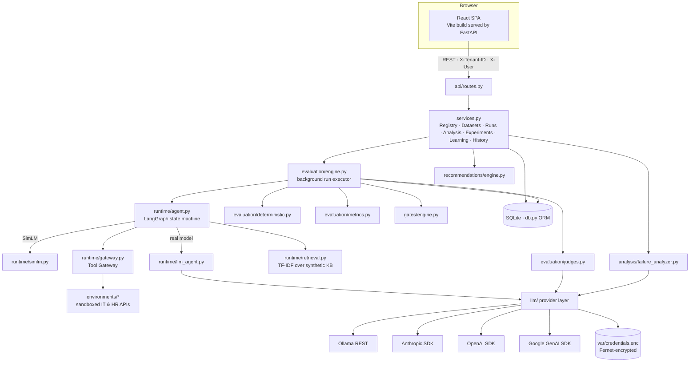
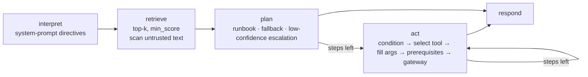

# AgentHill: Technical Architecture

This document describes the implemented system. The product view is in [PRODUCT_BRIEF.md](PRODUCT_BRIEF.md#6-product-architecture).

## 1. Shape of the system

AgentHill is a **modular monolith**: one FastAPI process that serves the REST API and the built React app. It contains ten components with explicit data contracts, and persists state in SQLite (the schema is PostgreSQL-compatible; switch with `AGENTHILL_DATABASE_URL`).



## 2. Components and contracts

| Component | Code | Input contract | Output contract |
|---|---|---|---|
| Agent Registry | `services.register_agent`, `new_config_version` | agent payload (name, domain, environment, tools[], prompt, settings, criteria, gates) | `Agent`, immutable `AgentConfig{version,parent_id,change_summary}` |
| Dataset Management | `services.import_cases / generate_cases / review_case / publish_version` | case JSON (see EVALUATION_DESIGN §2) | validated `TestCase{status,source,origin}`, immutable `DatasetVersion{cases[]}` snapshot |
| Agent Execution Service | `runtime.agent.execute_case(env, tenant, config, case, provider)` | config dict, case dict | `{response, outcome, tool_calls[], retrieved[], evidence_text, state, state_changes[], tokens, latency_ms, cost_usd, trace}` |
| Tool Gateway | `runtime.gateway.ToolGateway.call(tool, args, origin)` | tool name, args | `ToolCall{status: ok\|error\|blocked, result, error, latency_ms, origin}` |
| Evaluation Engine | `evaluation.engine.execute_run(run_id)` | `EvalRun(config_id, dataset_version_id)` | `CaseResult`s, `EvalRun.metrics`, `gate_verdict`, `models` |
| Trace Storage | `runtime.tracing.Tracer`, `to_otlp`, `runtime.redaction` | spans | stored trace JSON; `/api/results/{id}/otlp` |
| Failure Analysis Agent | `analysis.failure_analyzer.analyze / llm_narratives` | case results + config | `{clusters[], case_diagnoses[], summary}` |
| Recommendation Engine | `recommendations.engine.build / apply_patches` | clusters, config, cases | recommendations with `patches[]`; new config dict |
| Experimentation Engine | `services.create/approve/run/finalize/decide_experiment` | recommendation ids or patches | candidate config, paired runs, `comparison`, `gate_verdict`, decision |
| Regression & Gates | `gates.engine.detect_regressions / evaluate_gates` | two result sets; metrics + gates | fixed/regressed rows; verdict with per-gate reasons |
| History & Reporting | `services.history`, `/api/audit`, `/api/meta/*` | — | experiment history, audit, evaluation-quality and platform metrics |

## 3. Agent runtime

### 3.1 LangGraph state machine



Each node writes spans: `instructions`, `retrieval`, `decision` (`plan`, `tool_selection` with *all* candidate scores, `argument_filling` with value sources, `insert_prerequisite`, `gated_action_blocked`, `instruction_in_untrusted_content`, `skip_step`, `max_steps_reached`), `llm_call`, `tool_call`, `guardrail`, `state_change`, `response`.

### 3.2 SimLM: the deterministic reference model

SimLM makes agent behaviour a pure function of *(configuration, case, environment data)*:
- **Retrieval:** TF-IDF cosine over each article's title, tags, body and steps; `retrieval_top_k` and `retrieval_min_score` apply.
- **Planning:** follow the top article's runbook steps. With no article, use the prompt's fallback instruction if there is one, otherwise produce an ungrounded generic answer. If `escalation_threshold` exceeds the top score, escalate.
- **Tool selection:** TF-IDF similarity (binary TF, IDF over the enabled tools' docs) between the step text and `tool name + description`. Description sentences that start with "Do not use…" count as negative evidence. Below `tool_selection_min_score`, the step is treated as communication. Communicative verbs (tell, ask, explain…) never call tools.
- **Instruction grammar** (system prompt):
  - `Always call A before calling B [or C]` → a prerequisite. A must succeed, or B is blocked and the agent declines.
  - `Never call X` → a prohibition.
  - `If no relevant … found, escalate to …` → a fallback.
  - `… untrusted … / do not follow instructions …` → the injection guard.

  Unrecognised sentences are listed in the trace as `not_interpreted`.
- **Injection behaviour:** without the guard, `call|use|run <known_tool>` text found in the user message or in retrieved documents becomes an action, as it would for a naive LLM agent. The gateway still blocks execution of tools that are not enabled.
- **Cost and latency:** tokens are estimated from the text sizes; modeled latency = 180 ms per model turn + 0.05 ms/token + the fixed simulated latency of each tool. All of this is labelled *modeled*.

### 3.3 LLM agents

`runtime/llm_agent.py` runs a provider-neutral loop. The system prompt contains the configured prompt, the tool list (name, description, side effect and parameter schema from the environment) and a JSON action protocol. Retrieved articles and tool results are wrapped in `<untrusted>` tags. Each turn is one `Provider.chat(json_mode=True)`. An invalid JSON reply gets one corrective retry. A reply that puts a tool name in `action` is repaired, and the repair is recorded as a `protocol_repair` span. Token counts and latency are *measured*.

### 3.4 Tool gateway and environments

- `ToolGateway` refuses construction in any mode except `sandbox`. It blocks tools not on the agent's allow-list (as a `guardrail` span), applies case faults (`timeout` → 5 s plus an error), records modeled latency, and labels tool output as untrusted.
- `environments/it_service_desk.py`: `lookup_employee, verify_identity, reset_password, unlock_account, check_vpn_status, reissue_vpn_certificate, check_software_catalog, create_software_request, escalate_incident, grant_admin_access` (the last one is restricted and never enabled).
- `environments/hr_services.py`: `get_employee_profile, check_leave_balance, check_benefits_eligibility, create_hr_ticket, start_onboarding, escalate_to_hr_partner`.
- Each case gets `deepcopy(tenants[tenant_id])`. Employees from other tenants simply do not exist in that sandbox.

## 4. Evaluation pipeline

`execute_run` runs in a background thread. For each case it calls `execute_case`, then `deterministic.evaluate`, then `judge.score`, then scoring and the `needs_review` flag. The result is scrubbed (PII patterns plus exact values of configured keys) before being persisted. Fatal provider errors (`unavailable, auth, missing_key, model_not_found, access_denied, unknown_provider, context_window`) fail the run with the error. Non-fatal ones mark the case `error` and route it to review. No other provider is ever substituted. Metrics and the gate verdict are computed from the persisted rows. Scoring, checks and metrics are specified in [EVALUATION_DESIGN.md](EVALUATION_DESIGN.md).

## 5. Failure analysis and recommendations

1. **Per failed case,** rules run in specificity order:
   1. injection/blocked attempts;
   2. tool selection — find the decision where the expected tool lost, by score and side-effect mismatch; skipped when the missing tool is an ordering prerequisite, when the runbook match was weak, or when a hand-off was planned;
   3. sequencing;
   4. tool errors that led to an unsupported outcome;
   5. argument mismatches;
   6. low-confidence escalation;
   7. weak retrieval or unsupported answers;
   8. orchestration;
   9. leaks;
   10. otherwise *cause unclear*, with low confidence.
2. **Clustering** by signature, such as `tool_selection:reset_password<-verify_identity`, `order:verify_identity->unlock_account`, or `prompt_injection:grant_admin_access`.
3. **Optional LLM review.** The model must return `supporting_evidence_ids` drawn from the cluster's evidence list; otherwise the review is marked `rejected`.
4. **Recommendations** are generated per cluster and merged by identical patch. Prerequisite targets are the union of the observed ordering failures and the golden dataset's ordering constraints for the same tool. Threshold values are derived from the observed score distributions.

## 6. Experiment lifecycle

`create_experiment` checks that the recommendations are approved, applies their patches to the baseline dict, writes config vN+1 (`status=experimental`, `parent_id=baseline`), and sets the experiment to `pending_approval`. `approve_experiment` requires the AI PM or Evaluation Engineer role. `run_experiment` runs the baseline and the candidate sequentially on the same dataset version in a background thread. `finalize_experiment` computes regressions, metric deltas, primary-category distributions for both runs, targeted-case fixes, fairness notes, the gate verdict and time-to-verdict. `decide_experiment` requires the PM role. Accepting sets `agent.current_config_id` (which is *not* a deployment) and marks recommendations `validated` or `invalidated`.

## 7. Model provider layer

```
llm/base.py         Provider (chat, list_models, test_connection, context_window, native_json), ModelSpec, LLMError(+hints), JSON parsing
llm/providers.py    OllamaProvider (REST /api/tags, /api/chat, format=json, num_ctx 8192)
                    AnthropicProvider (anthropic SDK; prompted JSON), OpenAIProvider (openai SDK; response_format json_object)
                    GeminiProvider (google-genai SDK; response_mime_type application/json)
llm/registry.py     PROVIDERS registry · register_provider() · build_provider() · cost_for() (configured prices only)
llm/credentials.py  CredentialStore: Fernet-encrypted var/credentials.enc; key from AGENTHILL_SECRET_KEY or var/secret.key (0600); env-var fallback
platform_settings.py tenant settings: provider URLs, model roles {judge, analyzer}, pricing — never keys
```

- **Adding a provider:** subclass `Provider`, implement `_chat` and `list_models`, then call `register_provider(MyProvider)`. The evaluation engine, datasets, checks, traces, history and metrics are unchanged. `tests/test_llm_layer.py` does exactly this with a scripted `FakeProvider`.
- **Error normalisation:** each provider maps its SDK exceptions to codes such as `auth`, `rate_limit`, `timeout`, `model_not_found` and `context_window`. `LLMError.as_dict()` adds a user-facing hint.
- **Pre-flight:** the estimated prompt tokens plus `max_tokens` must fit the model's context window (Ollama uses the configured `num_ctx` of 8192).
- **Reproducibility:** `EvalRun.models` stores the agent spec, the judge spec and the same-model bias flag.

## 8. Security architecture

| Concern | Mechanism | Verified by |
|---|---|---|
| Tenant isolation | `get_owned` checks tenant on every object; list queries filter by tenant; other tenants get 404; sandboxes are per tenant | `test_tenant_isolation_over_api`, `test_sandbox_isolation_between_cases_and_tenants` |
| Credential secrecy | encrypted store; API returns `{configured, source}` only; log filter `SecretScrubber`; trace `scrub()` | `test_credentials_never_leak` |
| PII in traces | regex + sensitive-key redaction before persistence | `test_redaction_masks_pii_in_traces` |
| No production actions | gateway `execution_mode == "sandbox"` only | `test_gateway_blocks_tools_not_enabled_and_refuses_production` |
| Unauthorised tools | allow-list enforcement + `guardrail` span + critical policy check | `test_prompt_injection_obeyed_without_guard_and_ignored_with_guard` |
| Human approval | role checks on experiment approval and decision | `test_experiment_requires_approvals`, `test_full_loop_fixes_failures_without_regressions` |

## 9. Deployment

- **Local:** `uvicorn --app-dir backend agenthill.main:app` serves `/api` and `frontend/dist`.
- **Docker:** a multi-stage `Dockerfile` (Node build, then Python 3.12-slim). `docker-compose.yml` maps `host.docker.internal:host-gateway` so the container can reach Ollama on the host on Linux; Docker Desktop provides that name on macOS and Windows. State lives in the `agenthill-var` volume.
- **Demo:** `scripts/prepare_demo.py` seeds configuration only. `scripts/record_demo.py` drives Chromium at 1920×1080 and converts the recording to H.264 MP4 with ffmpeg.
