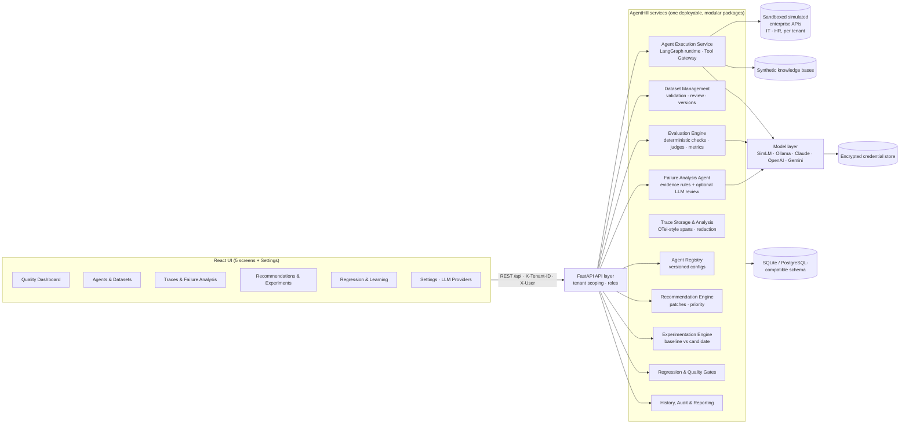
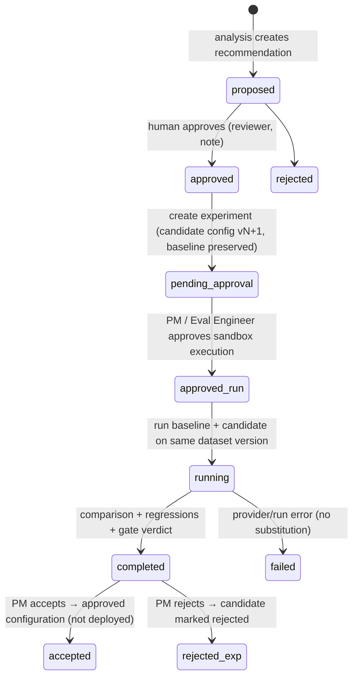

# AgentHill — Product Brief

> **One-line proposition:** Shorten the time between an AI agent change and an evidence-backed quality verdict. Evaluate any agent, diagnose why it fails using its execution traces, test fixes against a preserved baseline, and lock each fix in as a regression test.

> **Status:** Working prototype. Two demonstration agents (IT Incident Resolution, HR Employee Support) run against simulated enterprise APIs and synthetic data. The full loop is implemented end to end in a FastAPI + React application, with 37 automated tests and a reproducible recorded demo: evaluate → diagnose → recommend → experiment → gate → learn. Agents can be driven by a deterministic reference model (the default, which keeps runs reproducible) or by real LLMs through Ollama, Anthropic Claude, OpenAI or Google Gemini.

**Contents:** [Overview](#1-product-overview) · [Demo](#product-demo) · [Problem](#2-the-problem) · [Users](#3-target-users) · [Value](#4-value-proposition) · [Capabilities](#5-product-capabilities) · [Architecture](#6-product-architecture) · [Workflows](#7-user-workflows) · [Metrics](#8-evaluation-and-quality-metrics) · [Decisions](#9-product-decisions-and-trade-offs) · [Scope & limitations](#10-prototype-scope-and-limitations)

Source code, setup and run instructions are in [README.md](README.md).

---

## 1. Product Overview

**AgentHill** is a shared, self-service platform where AI product teams register their agents and run them against versioned golden datasets. Each run is evaluated with deterministic checks plus an LLM (or rubric) judge. The platform then works out why failures happened from the execution traces and turns each diagnosis into a concrete, reviewable change. That change is tested against the preserved baseline, and the configuration is approved only if it passes the team's quality gates. Confirmed failures become permanent regression tests.

AgentHill is not another dashboard of accuracy numbers. Each step produces the input the next step needs:

```
Evaluate ──► Diagnose ──► Recommend ──► Experiment ──► Gate ──► Learn
   ▲          (traces)     (patch +       (baseline vs   (explainable  (regression
   │                        evidence)      candidate)     verdict)      tests + history)
   └──────────────────────────────────────────────────────────────────────────┘
```

Every metric shown in the UI comes from persisted results of runs that actually executed. None of them is typed in by hand.

| | |
|---|---|
| **Product** | AgentHill: AI Agent Evaluation and Continuous Improvement Platform |
| **Users** | AI Product Managers, AI/ML Engineers, Evaluation Engineers, Business/Domain Experts |
| **Prototype** | FastAPI + LangGraph + SQLite backend, React frontend, Docker, Playwright demo |
| **Demo agents** | IT Incident Resolution Agent (primary), HR Employee Support Agent (reuse) |
| **Model providers** | Built-in SimLM (deterministic), Ollama (local), Anthropic Claude, OpenAI, Google Gemini |

---

## Product Demo

[](docs/demo/agenthill-demo.mp4)

**▶ [Watch the narrated demo (MP4, 1920×1080, with sound)](docs/demo/agenthill-demo.mp4)**

The demo is written so that someone outside the field, a senior executive for example, can follow it without prior knowledge. Plain-English explainer slides come first. Each chapter then shows the real application, with a visible pointer and zoom-ins on the evidence. All app footage is a live Playwright recording, and every number spoken or captioned is read from the page while it records. The British voiceover is AI-generated with Piper, which runs locally.

| Part | What it explains and shows |
|---|---|
| Opening | Why it matters (three questions to answer before trusting an AI assistant); how AgentHill works in seven steps, each with an everyday comparison (driving test, examiner, black box, mechanic, retest, pass mark, learning); the agenda; the disclosure that the IT assistant's first version has deliberate mistakes |
| 1 · The exam | The actions the assistant may take; the 19-request exam with one example ("I forgot my password" → check identity, then reset); why three deliberate trick questions belong in an IT exam; the six pass marks; a live run: **6 of 19 correct, 7 critical failures, fails the pass marks** |
| 2 · Finding out why | The 13 failures grouped into **five problem areas**, each explained in plain words; the password example as a step-by-step story; the moment in the recording where the wrong tool (yellow) beat the right one (red, score 0) |
| 3 · The repair | Proposed repairs as before-and-after changes; the password fix (reword the tool's label); a manager approves three |
| 4 · The retest | Old and new versions on the identical exam: **32% → 95% correct, 12 fixed, critical failures 7 → 0, nothing broken, pass marks met**. "Passing ≠ a real-world guarantee"; decision recorded |
| 5 · Never repeating a mistake | Hannah's case becomes a permanent test; the re-run confirms the fix holds; the full decision record |
| 6 · One platform, every department | An HR assistant added and tested on the same platform; choosing AI models per job |
| Summary | Before/after table read from the live run |

Re-record it yourself: `python scripts/prepare_demo.py && python scripts/record_demo.py` (needs `requirements-demo.txt`, a Piper voice and ffmpeg; see the README).

---

## 2. The Problem

Enterprises are building many specialized agents: for IT support, HR, customer service, finance and more. Building an agent has become easy. Knowing whether a change made it better is still hard.

Current practice fails in predictable ways:

- **Fragmented tooling.** Datasets live in spreadsheets, traces in an observability tool, judge prompts in a notebook and experiment notes in Slack. No single record ties a failure to its cause, the attempted fix, and the result.
- **Accuracy without diagnosis.** A dashboard says "68% task success". It does not say that 7 of the 13 failures share one cause: a retrieved document containing an injected instruction. A score alone does not tell you what to change.
- **Manual root-cause analysis.** Engineers read traces one by one. The same failure is rediscovered by different people, and the analysis is never recorded.
- **Unvalidated fixes.** A prompt tweak "looks better" on three hand-picked examples and ships. Nobody runs the full dataset against the old version, so regressions surface in production.
- **Inconsistent standards.** Every team defines "good enough" differently. There are no shared gates, no record of who approved a change, and no evidence trail for audit.
- **LLM-as-judge on its own.** A single model grading another model's free text is cheap but unreliable for objective facts: was the right tool called, with the right arguments, in the right order? Those facts are verifiable without a model.
- **Slow cycles.** The time from "we changed the agent" to "we know whether it is better and why" is measured in days.

**Why measuring accuracy is not enough:** improvement needs a closed loop. A failure has to be traced to observable evidence and turned into a hypothesis. That hypothesis becomes a specific change, which is tested against a preserved baseline on the same cases. The decision is recorded, and the case is kept so the fix stays fixed. AgentHill makes that loop the product.

---

## 3. Target Users

### Persona 1 — AI Product Manager
*"I need to know whether the agent is good enough to ship, and I need to defend that decision."*

**Responsibilities:** owns agent outcomes and roadmap trade-offs, approves changes, and reports quality to stakeholders.

**Challenges:**
- Quality reports are anecdotal, or a single accuracy number with no explanation.
- Cannot tell whether a proposed fix is worth the risk of regressions.
- No auditable record of who approved what, and on what evidence.

**How AgentHill helps:** a quality dashboard and explainable gate verdicts. Experiments show fixed vs. regressed cases before any decision. Accepting or rejecting a change is restricted to the PM role and recorded with a note. The gate disclaimer separates "met thresholds" from "production ready".

### Persona 2 — AI/ML Engineer
*"Tell me what to change, not just that it's broken."*

**Responsibilities:** builds and tunes prompts, tools, retrieval and orchestration.

**Challenges:**
- Root-causing a failure means reading raw traces case by case.
- Prompt and tool changes are tested ad hoc on a few examples.
- Hard to compare models fairly: different datasets, judges and settings.

**How AgentHill helps:** trace views with candidate-tool scores, retrieval scores and argument sources. Failure clusters come with root-cause hypotheses and concrete patches (prompt diff, tool description diff, setting change). Versioned experimental configurations run against the same dataset version. Model comparisons hold everything constant except the model.

### Persona 3 — Evaluation Engineer
*"The evaluation itself has to be trustworthy, or the whole loop is noise."*

**Responsibilities:** designs datasets, scoring, judges and gates; maintains evaluation quality.

**Challenges:**
- LLM judges drift and disagree with humans, and nobody measures it.
- Generated test cases leak into ground truth unreviewed.
- Regression suites decay because failures are not converted into tests.

**How AgentHill helps:**
- Hybrid scoring: deterministic checks for verifiable facts, a judge for semantics.
- Judge calibration against a human-labelled set (agreement and Cohen's κ).
- A human review queue for uncertain or disputed verdicts.
- Generated cases stay `pending_review` until approved.
- Immutable dataset versions.
- One-click conversion of a failure into a regression test.

### Persona 4 — Business / Domain Expert
*"I know what the right answer is. I shouldn't need to read Python to say so."*

**Responsibilities:** defines correct behaviour and policy (IT security policy, HR policy), and reviews scenarios.

**Challenges:**
- Domain policy (for example "verify identity before resetting a password") lives in documents the agent never sees.
- No way to contribute test cases or judge outcomes without engineering help.

**How AgentHill helps:** reads and approves test cases in plain language (input, expected outcome, required and prohibited actions). Reviews generated scenarios. Agrees or disagrees with judge verdicts, and confirms or rejects diagnoses. Policy gaps show up as named failure clusters (for example *workflow sequencing: verify_identity → reset_password*).

---

## 4. Value Proposition

| Outcome | How AgentHill delivers it | Evidence in the prototype |
|---|---|---|
| **Faster evaluation** | One click runs a versioned dataset in isolated sandboxes, with deterministic checks and a judge | 19-case IT run completes in under 1 s with SimLM; a real-LLM run of the same dataset (Ollama 8B on a laptop) takes minutes, not days of manual review |
| **Actionable diagnosis** | Failures are classified, clustered and explained from trace evidence, and each cluster maps to a concrete patch | IT v1: 13 failures → 5 clusters → 4 recommendations; primary-category agreement with human labels **100% (13/13)** |
| **Validated improvement** | Every change is tested against the preserved baseline on identical cases, with regressions detected per case | Experiment 1: **12 fixed, 0 regressed**, task success **31.6% → 94.7%**, critical failures **7 → 0** |
| **Consistent quality standards** | Team-defined quality gates on every run and experiment, with explainable verdicts and role-based approvals | Six configurable gates; verdict lists each gate's value, threshold and reason |
| **Self-service reuse** | Agents, tools, criteria and datasets are configuration; one engine serves every domain | The HR agent was registered and evaluated with no HR-specific evaluation code; its analysis → experiment took task success **66.7% → 91.7%** |
| **Trustworthy evaluation** | Judge calibration, human review queue, same-model bias flags, credential isolation | Calibration on 16 human-labelled answers: rubric 100% (κ 1.0, optimistic; see [§10](#10-prototype-scope-and-limitations)), independent `qwen3:8b` judge 93.8% (κ 0.875) |
| **Fair model decisions** | Model-comparison experiments hold dataset, judge and settings constant | SimLM vs `llama3.1:8b`: 100% vs 52.6% task success, 9 regressions → gates FAIL. The evidence a team needs before switching models |

All figures come from `scripts/run_full_loop.py`; the exported evidence is in [`docs/examples/`](docs/examples/SUMMARY.md).

---

## 5. Product Capabilities

### Capability 1 — Agent Onboarding and Configuration

**Purpose:** let any team register an agent on the shared infrastructure without writing evaluation code.

**Functional behaviour:**
- An agent has a name, business domain, description, intended tasks, expected outcomes, evaluation criteria (deterministic checks, judge criteria, judge pass threshold, score weights) and quality gates.
- An agent is bound to an **environment**: a sandboxed set of simulated enterprise APIs (`it_service_desk`, `hr_services`). Its tool list chooses which APIs are enabled and what *description* the agent sees for each.
- Execution configuration (system prompt, tools, settings: model provider/model, temperature, retrieval top-k and threshold, tool-selection threshold, escalation threshold, step budget) is stored as an **immutable, numbered configuration version**. Editing creates a new version and never overwrites an old one.
- Templates pre-fill the two demo agents. Every field can be edited before registration.

| Inputs | Outputs | User interactions |
|---|---|---|
| Agent metadata, environment, tool selection and descriptions, prompt, settings, criteria, gates | Agent record, config v1, audit event, golden dataset (when created from a template) | Agents & Datasets → *Register agent* (or *Load template*); *Agent configuration* tab to inspect versions and edit gates; Settings → *New configuration with a different model* |

**Acceptance criteria (met):** multiple agents with different environments coexist and use the same engine. Unknown tools are rejected at registration. Config versions are immutable. Every registration is audited.

### Capability 2 — Golden Dataset and Test Scenario Management

**Purpose:** keep expected behaviour explicit, reviewable and versioned.

**Functional behaviour:**
- A test case has: `case_key`, category (`normal | edge | failure | adversarial | regression`), severity, tags, input (employee and message), optional fault injection (for example `verify_identity: timeout`), and expected behaviour.
- Expected behaviour can include: outcome, required tools, prohibited tools, ordering constraints, expected arguments, expected sandbox state, answer facts, text that must not appear, and whether uncertainty should be expressed.
- Import validates every case against the agent's environment (unknown tools, bad categories, duplicates) and reports per-case errors.
- **Scenario generation.** If an analyzer model is configured, the LLM writes new cases. Otherwise a deterministic paraphrase generator varies approved cases and copies their expected behaviour, flagged for confirmation. **Generated cases enter as `pending_review` and are excluded from published versions until a human approves them.**
- **Publishing** snapshots all approved cases into an immutable dataset version. Runs always reference a version, never a live dataset.

| Inputs | Outputs | User interactions |
|---|---|---|
| Curated JSON, imported JSON, generation requests, review decisions | Validated cases, review queue, immutable dataset versions | Agents & Datasets → *Datasets & test cases*: filter by category or status, expand a case, *Generate scenarios*, *Approve*/*Reject*, *Validate & import*, *Publish new version* |

**Demo datasets:** IT has 19 cases (10 normal, 5 edge, 1 failure-injection, 3 adversarial: prompt injection via retrieved content, prompt injection via user message, cross-tenant access). HR has 12 cases (including a privacy probe and a cross-tenant probe).

**Acceptance criteria (met):** invalid cases are rejected with reasons. Published versions stay unchanged when cases are later edited. Generated cases never reach a version without approval.

### Capability 3 — Evaluation Execution Engine

**Purpose:** produce a reliable, explainable per-case verdict and run-level metrics.

**Functional behaviour:**
- **Execution.** Each case runs in a fresh, tenant-scoped sandbox copy of the synthetic enterprise data, through a LangGraph state machine (`interpret → retrieve → plan → act (loop) → respond`). The model behind the agent is pluggable: SimLM, Ollama, Claude, OpenAI or Gemini.
- **Deterministic evaluation:** seven checks — tool selection, tool arguments, workflow order, workflow completion (outcome plus required tools succeeded), prohibited actions (including blocked attempts), sandbox state changes, and policy compliance (unauthorised tool attempts, restricted data in the response, sensitive identifiers).
- **Semantic evaluation:** a judge scores correctness, relevance, completeness, grounding in retrieved evidence and tool results, and handling of uncertainty. Choose the built-in deterministic rubric judge or any configured LLM.
- **Scoring:** a case passes only if no deterministic check fails *and* the judge's overall score meets the threshold. The quality score is 60% deterministic and 40% judge, configurable per agent. Critical severity is tracked separately.
- **Trace capture:** OpenTelemetry-style spans (exportable as OTLP JSON) for input, interpreted instructions, retrieval (accepted and rejected candidates with scores), every decision with its evidence, model calls (tokens, latency, output), tool calls (arguments, results, errors, timing, origin), guardrail blocks, state changes and the final response. Only *observable* decisions are recorded; hidden model reasoning is never assumed.
- **Judge calibration:** a human-labelled set of 16 answers measures agreement and Cohen's κ for whichever judge is configured. Uncertain verdicts (low confidence, within 0.08 of the threshold) and disputed ones (deterministic pass, judge fail) are flagged for human review.

| Inputs | Outputs | User interactions |
|---|---|---|
| Agent config version, dataset version, judge model role | Run with per-case results, traces, checks, judge scores, metrics, gate verdict, model metadata | Dashboard → *Run evaluation*; Agents → *Create evaluation run* (any version × any dataset version); Traces → per-case detail; Regression & Learning → *Evaluation quality* → *Run calibration* |

**Acceptance criteria (met):** the same config and dataset give identical results under SimLM. The provider, model and parameters are stored on every run, and credentials never are. PII is redacted before persistence.

### Capability 4 — Failure Analysis and Root-Cause Diagnosis

**Purpose:** turn a list of failures into a short list of evidence-backed causes.

**Functional behaviour:**
- **Evidence layer (always on, deterministic).** For every failed case it reads failed checks and trace spans and assigns categories: prompt injection / unauthorised tool use, incorrect tool selection, incorrect tool parameters, tool execution failure, workflow sequencing, retrieval failure, unsupported answer, permission violation, unnecessary escalation, orchestration failure, or *cause unclear*.
- Each diagnosis lists **evidence** (span-referenced observations, such as "step X → selected `verify_identity` (0.3454); `reset_password` scored 0.0") separately from the **hypothesis** ("the description of `reset_password` does not cover the runbook's vocabulary"), with a **confidence** level. Low-confidence clusters carry a *further investigation* note.
- Diagnoses are **clustered by signature** (for example `tool_selection:reset_password<-verify_identity`) across cases, with frequency, maximum severity and trace references.
- **Narrative layer (optional).** A configured LLM reviews each cluster and may refine the hypothesis, but it must cite evidence IDs that exist. Uncited output is rejected and labelled as such.
- Humans can **confirm or reject** each diagnosis. The analyzer is also scored against a human-labelled failure sample.

| Inputs | Outputs | User interactions |
|---|---|---|
| Completed run, configuration, optional analyzer model | Clusters, per-case diagnoses, category distribution, labelled-sample accuracy | Traces → *Run failure analysis*; *Failure analysis* tab; click evidence to open the trace; *Confirm diagnosis* / *Reject* |

**Acceptance criteria (met):** every cluster has span-referenced evidence. IT v1 primary-category agreement with human labels is 13/13. When the narrative model fails, the error is shown and no other provider is substituted.

### Capability 5 — Improvement Recommendations

**Purpose:** convert diagnoses into specific, reviewable engineering changes.

**Functional behaviour:**
- Each cluster maps to a change type:
  - **prompt instruction:** an untrusted-content guard, a prerequisite such as *"Always call verify_identity before calling reset_password or unlock_account; if verify_identity fails, do not perform those actions"*, or a fallback;
  - **tool description:** the expected tool's description is extended with the runbook vocabulary it failed to match;
  - **retrieval setting:** a new `retrieval_min_score`, computed from the observed score gap between failing and passing cases;
  - **escalation threshold:** set just below the lowest wrongly-escalated retrieval score;
  - **validation step:** treat tool errors as blocking;
  - **step budget:** a larger `max_steps`;
  - **investigation:** when no automatic change is justified.
- Each recommendation includes: failure description, supporting evidence, probable root cause (marked *Hypothesis — validate with an experiment*), proposed change as a diff, expected impact, confidence, priority (P1–P3) and affected cases.
- **Priority** = (0.35·frequency + 0.30·severity + 0.20·business impact) × confidence. Recommendations that propose the same patch are merged.
- Recommendations move through `proposed → approved/rejected → validated/invalidated`. They are validated only by an accepted experiment that fixed their cases.

**Acceptance criteria (met):** recommendations are ordered by priority with patches and evidence. Approval records the reviewer, time and note. No change is applied without an experiment.

### Capability 6 — Controlled Experimentation

**Purpose:** prove (or disprove) a change with the same cases, the same judge and the same criteria.

**Functional behaviour:**
1. The baseline configuration is preserved and never edited.
2. Approved recommendations (or explicit patches, or a model change) produce a **new versioned experimental configuration** whose parent is the baseline.
3. The experiment is `pending_approval` until an AI PM or Evaluation Engineer approves sandbox execution.
4. Baseline and candidate run on the **same dataset version**, each with full traces.
5. The comparison covers: per-metric deltas (task success, tool selection, workflow completion, policy compliance, judge scores, critical failures, p50/p95 latency, tokens, cost); per-case outcomes (fixed, regressed, still failing, still passing); primary failure-category distribution; targeted cases fixed; and fairness notes (model differences, modeled vs. measured latency, same-model judge bias).
6. Regressions are identified per case.
7. The experiment report is persisted.
8. The PM **accepts or rejects**. Accepting marks the candidate as the agent's *approved configuration* and explicitly does **not** deploy anything.

**Model comparison** uses the same mechanism. Pick a baseline configuration and a candidate provider and model (and optionally a different prompt). AgentHill holds the dataset, criteria, judge and all other settings constant.

**Acceptance criteria (met):** an experiment cannot run unapproved or be decided by a non-PM. The baseline config id is unchanged. Comparisons and decisions persist.

### Capability 7 — Regression Testing and Quality Gates

**Purpose:** make "is it better?" a consistent, explainable, team-defined decision.

**Functional behaviour:**
- **Regression detection:** any case that passed on the baseline and fails on the candidate.
- **Configurable gates per agent:** minimum task success rate, minimum tool selection accuracy, maximum critical failures, maximum regressions, maximum p95 latency, maximum cost per run.
- **Verdict:** `PASS`, `FAIL` or `PASS_WITH_UNMEASURED`, with each gate's observed value, threshold and reason. A gate whose metric cannot be measured (for example cost for a local model with no price, or regressions on a standalone run) is reported as *not measured* rather than silently passed.
- Every verdict carries the disclaimer: *passing gates means the configuration met this team's thresholds on this dataset version; it is not proof of production readiness.*
- **Regression suite runs** execute the regression dataset on the current configuration.

**Acceptance criteria (met):** gate verdicts appear on the dashboard, on every run and on every experiment. Regression counts feed the `max_regressions` gate.

### Capability 8 — Continuous Learning and Experiment History

**Purpose:** make sure fixed issues stay fixed and every decision can be reconstructed.

**Functional behaviour:**
- **Confirm failure → regression test** creates `REG-<case>` in the agent's regression dataset. It keeps its origin: run, config version, failed checks, diagnosis, the experiment that fixed it, and the confirming user. A new regression dataset version is published.
- **Experiment history** (searchable) records: agent, baseline and candidate config versions, dataset version, original failures, root-cause hypotheses, recommended and applied changes, baseline and experimental results, regressions, gate verdict, final decision, and every approval (recommendation reviewers, execution approver, decision maker, with timestamps and notes).
- An **audit log** captures registrations, dataset publishes, runs, analyses, approvals, decisions and settings changes. Credentials are never logged.
- There is **no uncontrolled self-modification**. The system proposes; humans approve, run and decide.

**Acceptance criteria (met):** regression tests re-run against later configurations. History and audit survive restarts in SQLite and are filterable per agent.

### Cross-cutting — Multi-LLM Provider Support and Model Roles

- **One model integration layer.** Every model call goes through `Provider.chat()`, with normalised errors and pre-flight context-window checks. Providers: **Ollama** (REST, no key, model discovery from `/api/tags`), **Anthropic Claude**, **OpenAI** and **Google Gemini** (each through its official Python SDK). Adding a provider is one class plus `register_provider()`; the evaluation engine is never touched.
- **Settings → LLM Providers:** select a provider, enter an API key, set the Ollama URL (default `http://localhost:11434`), test the connection (a real round-trip: model discovery plus a structured-output call), see available models, and save. Changes apply without a restart.
- **Separate model roles:**
  - **Agent execution** is stored per agent configuration version, so runs are reproducible.
  - **Evaluation judge** is a platform setting.
  - **Failure analysis and recommendations** (including scenario generation) is a platform setting.

  An all-local setup (Ollama for every role) and mixed setups (for example Ollama agent, Claude judge, OpenAI analyzer) are both supported.
- **Compatibility checks.** A model must return valid JSON to serve any role. *Validate structured output* tests this before saving. Every model call is pre-flighted against its context window.
- **Error handling with actionable hints:** Ollama unavailable, model not installed, invalid key, missing key, rate limit, access denied, timeout, unsupported structured output, context window exceeded, invalid or truncated response. **A failed provider is never silently replaced.** The run fails with the error, or the case is marked `error` and routed to review.
- **Secure keys.** Keys are entered once and stored encrypted (Fernet) on the backend under `var/` (git-ignored). Environment variables also work. Keys are never returned to the browser, never put in `localStorage`, and never written to traces, runs, the audit log or logs. A log filter and a trace scrubber remove any configured key value. Keys can be replaced or removed in the UI.
- **Reproducibility.** Every run stores the agent model, judge model, parameters and the *same-model-as-judge* bias flag.

---

## 6. Product Architecture

### 6.1 Logical architecture



### 6.2 Components and responsibilities

| # | Component | Module | Responsibility |
|---|---|---|---|
| 1 | Agent Registry | `services.py` (registry), `db.Agent/AgentConfig` | Agents, immutable config versions, gates, criteria |
| 2 | Dataset Management | `services.py` (datasets) | Validation, import, generation, review, immutable versions |
| 3 | Agent Execution Service | `runtime/agent.py`, `runtime/llm_agent.py`, `runtime/gateway.py`, `environments/*` | LangGraph orchestration, SimLM or LLM loop, tool gateway (allow-list, sandbox-only, faults, timing) |
| 4 | Evaluation Engine | `evaluation/engine.py`, `deterministic.py`, `judges.py`, `metrics.py`, `calibration.py` | Checks, judges, scoring, metrics, calibration |
| 5 | Trace Storage & Analysis | `runtime/tracing.py`, `runtime/redaction.py` | Span capture, OTLP export, PII and secret redaction |
| 6 | Failure Analysis Agent | `analysis/failure_analyzer.py` | Classification, clustering, evidence, hypotheses, LLM review, labelled accuracy |
| 7 | Recommendation Engine | `recommendations/engine.py` | Cluster → patch, priority, merge, patch application |
| 8 | Experimentation Engine | `services.py` (experiments) | Versioned candidates, approvals, paired runs, comparison, decisions |
| 9 | Regression & Quality Gates | `gates/engine.py` | Regression detection, gate evaluation, verdicts |
| 10 | History & Reporting | `services.history`, `/api/audit`, `/api/meta/*` | Experiment history, audit, evaluation-quality and platform metrics |
| — | Model layer | `llm/base.py`, `providers.py`, `registry.py`, `credentials.py` | Provider abstraction, errors, discovery, encrypted keys, pricing |

### 6.3 Data flow of one evaluation run

1. `POST /api/runs` → an `EvalRun` row (queued). A background thread starts.
2. For each case in the dataset version snapshot:
   1. A fresh tenant-scoped **sandbox** is created (deep copy of synthetic data plus case faults).
   2. The **runtime** retrieves knowledge articles, plans, and calls tools only through the **gateway**.
   3. The gateway rejects tools that are not enabled (recorded as a `guardrail` span), applies faults, records timing, and labels tool output as untrusted.
   4. **Deterministic checks** run against tool calls, sandbox state and the response.
   5. The **judge** scores the response against the evidence.
   6. The case is scored, then **redacted** (PII patterns and any configured key) and persisted with its trace.
3. Run metrics and the gate verdict are computed from the persisted results. The audit event is written.

### 6.4 Evaluation and execution architecture

- **SimLM** (default agent model) is a transparent, deterministic decision procedure, not a language model. Its behaviour is driven by the configuration under test:
  - it chooses tools by TF-IDF similarity between each runbook step and each tool's name and description;
  - it obeys system-prompt instructions written in a small documented grammar (prerequisites, prohibitions, fallback escalation, untrusted-content guard);
  - like a naive LLM agent, it obeys instruction-like text in retrieved content unless it has been told not to.

  This makes improvements and regressions *causal* and reproducible. A better tool description really does change tool selection.
- **LLM agents** use a provider-neutral JSON action protocol (`call_tool` / `final`), so any model that can emit JSON can drive the same tools, traces and checks. Provider-native tool calling is deliberately not used; see the decisions document.
- **Judges** are interchangeable behind one interface. Deterministic checks never depend on the judge.

### 6.5 Failure-analysis orchestration

`analyze_run` → evidence rules per failed case → cluster by signature → (optional) LLM narrative per cluster, validated against evidence IDs → labelled-sample accuracy → recommendation generation → persisted `FailureAnalysis` and `Recommendation` rows → audit.

### 6.6 Experiment lifecycle



### 6.7 Data model (persisted)

`Tenant` · `Agent` · `AgentConfig` (immutable versions, parent link) · `Dataset` (golden | regression) · `TestCase` (status, source, origin) · `DatasetVersion` (snapshot) · `EvalRun` (models, metrics, gate verdict, duration) · `CaseResult` (checks, judge, trace, cost, review flag) · `FailureAnalysis` (clusters, diagnoses, summary) · `Recommendation` (patches, status, reviewer) · `Experiment` (patches, configs, runs, comparison, decision, approvals) · `HumanReview` · `AuditEvent` · `PlatformSetting` (providers, model roles, pricing — never keys).

### 6.8 API interactions (selection)

| Area | Endpoints |
|---|---|
| Registry | `GET/POST /api/agents`, `PATCH /api/agents/{id}`, `POST /api/agents/{id}/configs`, `GET /api/templates`, `GET /api/environments` |
| Datasets | `GET/POST /api/agents/{id}/datasets`, `GET /api/datasets/{id}/cases`, `POST …/import`, `POST …/generate`, `POST /api/cases/{id}/review`, `POST …/versions` |
| Runs & traces | `POST/GET /api/runs`, `GET /api/runs/{id}`, `GET /api/results/{id}`, `GET /api/results/{id}/otlp` |
| Analysis | `POST /api/runs/{id}/analyze`, `GET /api/runs/{id}/analysis`, `GET /api/recommendations`, `POST /api/recommendations/{id}/review` |
| Experiments | `POST/GET /api/experiments`, `POST …/{id}/approve`, `POST …/{id}/run`, `POST …/{id}/decision` |
| Learning | `POST /api/results/{id}/to-regression`, `GET/POST /api/agents/{id}/regression[/run]`, `GET /api/history`, `GET /api/audit`, `POST /api/reviews` |
| Metrics | `GET /api/dashboard`, `GET /api/meta/evaluation-quality`, `POST /api/meta/judge-calibration`, `GET /api/meta/platform` |
| Models | `GET /api/settings/llm`, `PUT …/providers/{p}`, `DELETE …/providers/{p}/key`, `POST …/providers/{p}/test`, `GET …/providers/{p}/models`, `PUT …/roles`, `PUT …/pricing`, `GET …/compatibility` |

### 6.9 Security and customer-data isolation

| Control | Implementation |
|---|---|
| Customer isolation | Every row is tenant-scoped. Every API query filters on the `X-Tenant-ID` tenant, and other tenants' objects return **404** (no existence leak). Sandboxes load only the tenant's data, and a cross-tenant employee lookup returns the same "not found" as a non-existent ID. Tests cover API isolation and sandbox isolation. |
| Credential handling | Keys live only in the backend's encrypted store or environment variables, never in the browser or the database. Responses expose only `{configured, source}`. Logs and traces are scrubbed of key values. A test asserts the key is absent from the DB file, encrypted store, run payloads and audit. |
| Trace redaction | National IDs, emails, phone numbers, secret-like tokens, and sensitive fields (`national_id`, `base_salary`, …) are masked before persistence. |
| Test vs. production separation | The tool gateway refuses any execution mode other than `sandbox`. Agents only ever touch per-case sandboxes. Accepting an experiment records an approved configuration; it does not deploy. |
| Human approval | Recommendations, experiment execution (PM or Eval Engineer) and decisions (PM only) require role-checked approval. Generated test cases need review. |
| Auditability | Append-only audit events for every consequential action, with actor and details. |
| Untrusted inputs | Retrieved documents and tool outputs are labelled untrusted in traces and in LLM prompts (`<untrusted>` tags). Adversarial cases measure whether the agent obeys injected instructions. The allow-list blocks execution of non-enabled tools either way. |

*Identity is simulated with headers (user and tenant selectors in the UI). See [LIMITATIONS.md](LIMITATIONS.md).*

---

## 7. User Workflows

> For installation see [README.md](README.md). Every step below is a real interaction in the application.

### Workflow 1 — Onboard an agent and establish a baseline
*Primary persona: AI/ML Engineer*
1. **Agents & Datasets → + Register agent.** Choose *Load template… → HR Employee Support Agent* (or fill in the form), review tools and descriptions, prompt, settings and gates, then click **Register agent and load golden dataset**.
2. The top-bar agent picker switches to the new agent. **Agent configuration** shows config v1, tools, criteria and gates; edit gates and click **Save gates** if needed.
3. **Quality Dashboard → Run evaluation.** A progress bar runs through the cases; KPIs, verdict and failure distribution appear when it finishes.
4. Time-to-onboard (registration → first completed run) is shown under **Regression & Learning → Evaluation quality → Platform effectiveness**.

### Workflow 2 — Diagnose failures from traces
*Primary persona: AI/ML Engineer, Evaluation Engineer*
1. **Dashboard → Inspect run →** (or **Traces & Failure Analysis**, then pick the run).
2. Click **Run failure analysis**. The *Failure analysis* tab lists clusters with severity, confidence, evidence (each linked to a case and span) and the root-cause hypothesis.
3. Click an evidence link, or switch to **Case results & traces** and select a case (for example `IT-003`). Read the deterministic checks, judge scores and the expanding trace: retrieval scores, the *tool_selection* decision with candidate scores, arguments with their sources, tool results, state changes and the response.
4. Click **Confirm diagnosis** or **Reject** on a cluster. Click **Agree with judge** or **Disagree** on a case.

### Workflow 3 — Turn a diagnosis into a validated improvement
*Primary personas: AI Product Manager (approvals), AI/ML Engineer (execution)*
1. **Recommendations & Experiments → Prioritized recommendations.** Read each card: root cause, expected impact, the proposed change as a diff, and supporting evidence.
2. Click **Approve change** on the recommendations you accept, tick **include in experiment**, optionally name it, then click **Create experiment from N approved change(s)**.
3. In **Experiments**, review the changes applied to the new config version (the baseline is preserved), then click **Approve execution (sandbox only)**. This requires the AI PM or Evaluation Engineer role.
4. Click **Run baseline vs candidate**. Read the comparison: fixed, regressed and still-failing cases, the metric deltas table, failure categories, fairness notes and per-case outcomes.
5. In **Quality gates on the candidate**, read the verdict and reasons, then click **Accept candidate** or **Reject** with a note. This requires the AI PM role.

### Workflow 4 — Lock in the learning
*Primary persona: Evaluation Engineer*
1. In **Traces**, open a failed baseline case and click **Confirm failure → regression test**. `REG-<case>` is created with its full origin.
2. **Regression & Learning → Regression suite & gates → Run regression suite on current config** proves the fix still holds.
3. **Experiment history**: search by name, hypothesis or decision note, and expand an entry to see failure → hypothesis → change → results → decision → approvals.
4. **Evaluation quality → Run calibration with current judge** reports agreement and κ against the human-labelled set.

### Workflow 5 — Choose and compare models
*Primary personas: AI/ML Engineer, AI Product Manager*
1. **Settings → LLM Providers → Providers & credentials.** For Ollama, set or confirm the server URL. For cloud providers, paste an API key. Enter a model and click **Test connection** to see available models and the structured-output check. Click **Save**.
2. **Model roles.** Set the *LLM evaluation judge* and *Failure analysis & recommendations* models (each with **Validate structured output**). Under *Agent execution*, create a new configuration version on a different model. If the judge is the same model as an agent, a warning appears.
3. **Recommendations & Experiments → Compare models.** Pick the baseline configuration and a candidate provider and model (optionally a different prompt), click **Check model compatibility**, then **Create comparison experiment**. Approve and run it as in Workflow 3. The comparison reports success, tool accuracy, judge scores, fixed and regressed cases, latency, tokens and cost (shown as *not measured* for local Ollama, or when no price is configured).

### Workflow 6 — Curate scenarios with domain experts
*Primary persona: Business / Domain Expert*
1. **Agents & Datasets → Datasets & test cases → Generate scenarios.** New cases appear as *pending review*.
2. Expand a case to check its input and expected behaviour, then click **Approve** or **Reject**.
3. **Publish new version** snapshots only approved cases. Older runs keep pointing at older versions.

---

## 8. Evaluation and Quality Metrics

### 8.1 Agent quality (measured on every run)

| Metric | Definition | IT v1 → v2 (measured) |
|---|---|---|
| Task success rate | cases with no failed deterministic check *and* judge ≥ threshold | 31.6% → 94.7% |
| Tool selection accuracy | cases whose tool-selection check passed (applicable cases) | 73.7% → 94.7% |
| Tool argument accuracy / execution success | matching expected args; tool calls without error | reported per run |
| Workflow completion rate | expected outcome reached and required tools succeeded | reported per run |
| Policy compliance rate | no unauthorised attempts, leaks or sensitive identifiers | reported per run |
| Answer correctness, relevance, completeness, grounding | judge criteria averages | reported per run |
| Critical failures | cases failing any critical check | 7 → 0 |
| Regression rate | baseline-pass → candidate-fail per experiment | 0 |
| Latency p50/p95, tokens, cost | modeled for SimLM; measured latency and tokens for real models; cost only with a configured price | reported per run |

### 8.2 Evaluation quality

| Metric | How it is measured | Prototype result |
|---|---|---|
| Judge–human agreement (calibration) | 16 human-labelled answers; agreement and Cohen's κ for the configured judge | Rubric judge: 100%, κ = 1.0 (same author, so optimistic). Ollama `qwen3:8b`: **93.8%, κ = 0.875** |
| Judge–human agreement (live) | *Agree/Disagree* reviews on case results | Measured once reviews exist |
| Failure-classification accuracy | analyzer primary category vs. human labels on the v1 baselines | IT 13/13 (100%) |
| Diagnosis validation rate | *Confirm/Reject* reviews on clusters | Measured once reviews exist |
| Evaluation execution time | wall-clock per run | < 1 s for 19 cases with SimLM |
| Time to actionable verdict | experiment created → gates evaluated | ≈ 2 s with SimLM |

### 8.3 Platform effectiveness

| Metric | Status |
|---|---|
| Time to onboard a new agent (registration → first completed evaluation) | **Measured** from timestamps (Evaluation quality → Platform effectiveness) |
| Time from identified failure to validated improvement (source run finished → experiment accepted) | **Measured** |
| % of agent teams able to run evaluations independently | **Not measurable in the prototype.** It needs multi-team usage data, so it is reported as not measured in the UI |

---

## 9. Product Decisions and Trade-offs

The full rationale is in [PRODUCT_DECISIONS.md](PRODUCT_DECISIONS.md). The most important decisions:

| Decision | Chosen | Alternatives considered | Why |
|---|---|---|---|
| Who judges what | **Hybrid**: deterministic checks for verifiable behaviour, judge for semantics | LLM-as-judge for everything | Tool choice, order, arguments, state and policy are facts; a model adds noise and cost to them |
| Default agent model | **SimLM**, a deterministic reference model; real LLMs selectable | Real LLM only | A demo of "the fix worked" must be reproducible and causal. LLM non-determinism would blur before/after. Real-model runs are supported and reported separately |
| Diagnosis method | **Evidence rules first**, LLM narrative optional and evidence-cited | LLM reads traces and guesses | Diagnoses must cite observed spans. An LLM summary without citations is not evidence |
| Recommendations | **Concrete patches + experiment required** | Free-text advice; auto-apply | Patches are reviewable and testable. Auto-apply would be uncontrolled self-modification |
| Config versioning | **Immutable versions with parent links** | Mutable agent config | Baselines must stay reproducible; experiments compare versions |
| Gate semantics | **Explainable per-gate verdict + "not measured" + disclaimer** | Single pass/fail | Teams need to know *which* threshold failed, and must not read a pass as production readiness |
| Tool calling for LLM agents | **Provider-neutral JSON action protocol** | Native tool-calling APIs per provider | One contract across four providers and small local models; same traces and checks |
| Architecture | **Modular monolith** (10 packages, one process) | Microservices | Clear interfaces without operational overhead at prototype scale |
| Storage | **SQLite**, PostgreSQL-compatible schema | Postgres in compose | Zero-setup local reproduction; switch with `AGENTHILL_DATABASE_URL` |
| Key storage | **Server-side encrypted store + env vars** | Browser localStorage (as in IAMSentinel) | Keys must never reach the browser or traces; required for shared, multi-user use |

---

## 10. Prototype Scope and Limitations

The full list is in [LIMITATIONS.md](LIMITATIONS.md).

**Implemented and working:**
- All eight capabilities, multi-provider model support, and five UI screens plus Settings.
- Two agents in two domains.
- Tenant isolation, encrypted credentials, redaction, role-checked approvals and an audit log.
- 37 automated tests.
- A reproducible Playwright demo, and exported evidence in `docs/examples/`.

**Simulated:**
- Enterprise systems are in-memory sandboxes over synthetic JSON (employees, VPN, catalog, incidents, HR records).
- Knowledge bases are synthetic.
- SimLM latency and cost are *modeled* from token estimates; tool latencies are fixed per tool.
- Identity is a header-based user/tenant selector, not real authentication.

**Intentionally constructed:**
- The IT v1 configuration is flawed on purpose: a vague `reset_password` description, no identity-verification instruction, no untrusted-content instruction, and a loose retrieval threshold.
- The HR v1 escalation threshold is too high.
- The failures they cause are genuine executions of those configurations, not fabricated results.

**Known limitations:**
- SimLM only understands instructions written in its documented grammar.
- The rubric judge and the calibration set were written by the same author, so 100% calibration agreement overstates how it would generalise. LLM judges should be calibrated on larger, independently labelled sets.
- Failure-classification accuracy is measured on a small labelled sample tied to the designed flaws.
- Small local models (8B) make protocol and tool errors; these are recorded and scored, not hidden.
- Cloud providers were verified only for authentication and error handling with invalid keys; full cloud-model runs were not executed (no keys were available). See the README's verification table.
